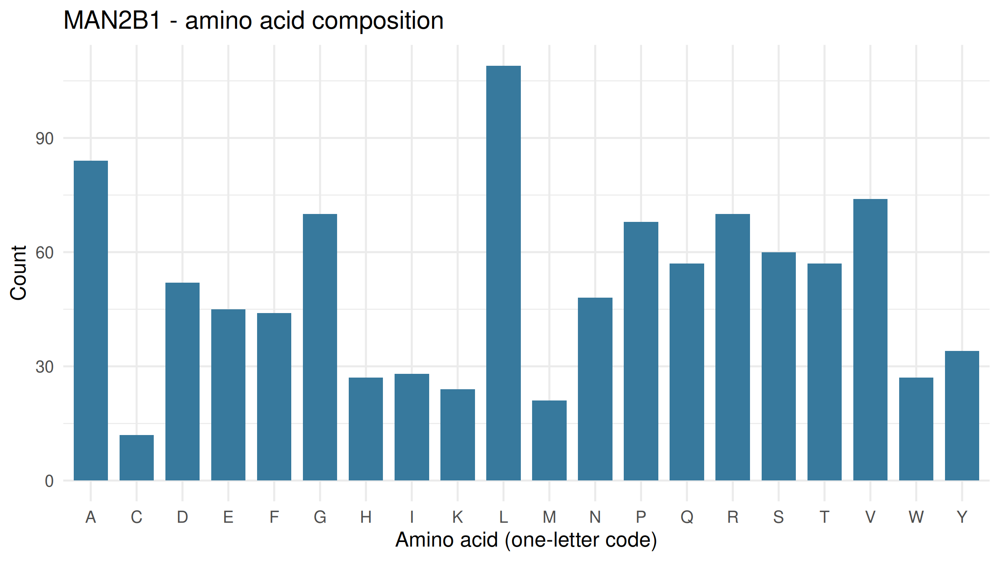
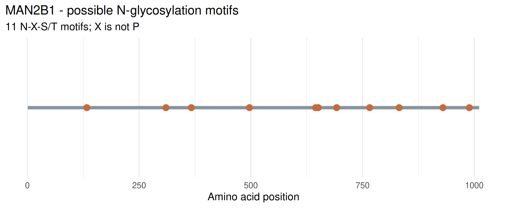

# Exploring Lysosomal Enzymes Using NCBI and R

## 1. Introduction

This project explores the human lysosomal enzyme encoded by the MAN2B1 gene. The protein sequence was obtained from the NCBI Protein database and analyzed using R to determine its amino acid composition and identify potential N-glycosylation motifs.

## 2. Gene and Protein Information

- **Gene symbol:** MAN2B1
- **Enzyme name:** Lysosomal alpha-mannosidase
- **Organism:** *Homo sapiens* (human)
- **NCBI RefSeq accession:** NP_000519.2
- **NCBI Protein record:** https://www.ncbi.nlm.nih.gov/protein/NP_000519.2

### Normal function

Lysosomal alpha-mannosidase is involved in the degradation of glycoproteins inside lysosomes. It helps break down mannose-containing carbohydrate structures by removing terminal alpha-linked mannose residues.

## 3. Methods

The human MAN2B1 protein sequence was downloaded from NCBI using the R package `rentrez`. The R script was used to calculate the total number of amino acids, count each amino acid, calculate amino acid percentages, and identify potential N-glycosylation motifs.

The potential N-glycosylation motif was defined as N-X-S/T, where N is asparagine, X is any amino acid except proline, and S/T is serine or threonine.

The analysis used the R packages `rentrez` and `ggplot2`. The results were saved as CSV files, and two figures were generated to visualize amino acid composition, and potential N-glycosylation motifs.

## 4. Results

**Table 1.** *Summary of MAN2B1 Protein Sequence Analysis.*

| Feature | Result |
|---|---|
| Gene | MAN2B1 |
| RefSeq accession | NP_000519.2 |
| Protein length | 1,011 amino acids |
| Potential N-glycosylation motifs | 11 |

### Amino acid composition

Leucine (L) was the most abundant amino acid in the analyzed sequence, with 109 residues (10.78%). Other relatively abundant amino acids included alanine (A), with 84 residues (8.31%); valine (V), with 74 residues (7.32%); and glycine (G) and arginine (R), with 70 residues each (6.92%).

**Figure 1.** *Amino acid composition.*

This figure shows the counts or composition of the amino acids identified in the MAN2B1 protein sequence.

**Figure 2.** *Potential N-glycosylation motifs.*

This figure presents the potential N-glycosylation motifs identified by the sequence analysis. These are predicted sequence motifs and do not confirm that glycosylation occurs at every site.

## 5. Answers to the Lab Questions

### Question 1. What does your enzyme normally break down inside lysosomes?

- Lysosomal alpha-mannosidase, encoded by the MAN2B1 gene, helps break down glycoproteins by removing terminal alpha-linked mannose residues from their carbohydrate chains. This activity contributes to the normal degradation and recycling of cellular materials inside lysosomes.

### Question 2. What is the total length of your protein, and which amino acids are most common?

- The analyzed MAN2B1 protein sequence contains 1,011 amino acids. Leucine (L) is the most abundant amino acid, with 109 residues (10.78%). Alanine (A) follows with 84 residues (8.31%), while valine (V) has 74 residues (7.32%). Glycine (G) and arginine (R) each have 70 residues (6.92%).

### Question 3. How many potential N-glycosylation motifs did you find? Where are they located?

- The sequence analysis identified 11 potential N-glycosylation motifs at the following amino acid positions:

**Table 2.** *Positions and Sequences of Potential N-Glycosylation Motifs in the MAN2B1 Protein.*
  
| Position | Motif |
|---:|---|
| 133 | NAT |
| 310 | NHT |
| 367 | NLT |
| 497 | NIS |
| 645 | NAS |
| 651 | NES |
| 692 | NFS |
| 766 | NQT |
| 832 | NGS |
| 930 | NLS |
| 989 | NIT |

These motifs match the N-X-S/T pattern, with no proline at the X position. Their presence indicates potential N-glycosylation sites but does not establish that they are actually glycosylated.

### Question 4. Why can glycosylation matter for lysosomal proteins? Does finding a motif prove the protein is glycosylated?

- Glycosylation can help lysosomal proteins fold properly, maintain stability, and move through the cell's protein-processing and trafficking pathways. Some lysosomal enzymes also receive mannose-6-phosphate tags that help direct them to lysosomes. However, an N-X-S/T motif alone does not prove that a protein is glycosylated at that position. Actual glycosylation depends on additional biological factors and must be confirmed experimentally or using appropriate glycoproteomic evidence. The motif analysis in this project does not determine whether the protein has a mannose-6-phosphate tag.

### Question 5. What could happen in the cell if your enzyme did not work properly?

- If lysosomal alpha-mannosidase does not function properly, mannose-containing oligosaccharides from glycoprotein degradation may accumulate inside lysosomes. This can interfere with normal cellular waste processing and is associated with alpha-mannosidosis, a lysosomal storage disorder. The sequence analysis performed in this project does not measure enzyme activity or diagnose a disorder.

## 6. Project Files

- `lysosomal_enzyme_analysis.r` — R script used to download and analyze the protein sequence.
- `data/MAN2B1.fasta` — protein sequence downloaded from NCBI.
- `results/MAN2B1_summary.csv` — summary of the sequence length and potential motif count.
- `results/MAN2B1_amino_acid_counts.csv` — amino acid counts and percentages.
- `results/MAN2B1_motif_positions.csv` — potential N-glycosylation motif positions.
- `figures/MAN2B1_amino_acid_composition.png` — amino acid composition figure.
- `figures/MAN2B1_potential_N_glycosylation.png` — potential N-glycosylation motif figure.

## 7. Conclusion

The MAN2B1 protein sequence was analyzed using R to examine its amino acid composition and potential N-glycosylation motifs. The sequence contains 1,011 amino acids, with leucine as the most abundant amino acid, and 11 potential N-glycosylation motifs. These results demonstrate how bioinformatics tools can be used to investigate protein sequence features. However, sequence-based predictions alone cannot confirm glycosylation or enzyme activity.

## References

1. National Center for Biotechnology Information (NCBI). MAN2B1 protein record, RefSeq accession NP_000519.2. https://www.ncbi.nlm.nih.gov/protein/NP_000519.2
2. R Core Team. R: A Language and Environment for Statistical Computing. https://www.r-project.org/
3. R packages: `rentrez` and `ggplot2`.
